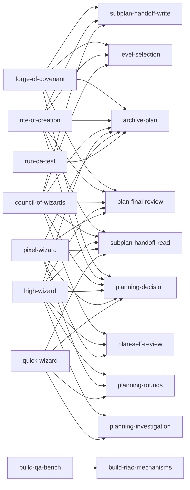

# High Wizard Plan

## **PROJECT INFO**
- **Project**: agent-memory-wizards
- **Date**: 2026-10-17
- **Agent**: meta
- **Theme**: Cohesion pass — verdict, repairs and a derived relationship map for the wizard set
- **Source Protocol**: `/high-wizard` — /high-wizard

*CRITICAL INSTRUCTION: To continue this plan: load the source protocol above, then inspect which sections below are filled vs unfilled to infer your current step.*

---

## **INHERITED CONTEXT**
*Filled at investigation step 0 with whatever was settled before this plan existed. The two sources are recorded separately and never merged — write "None" under a part that does not apply.*
*These decisions are **not yours to reopen**. If one looks wrong, STOP and surface it to [USER-NAME] — do not silently re-decide it here or in Confirmed Decisions below.*

### From the Parent Plan
- **Parent plan**: [`core-plan.md`](core-plan.md), the council that owns this work
- **Assigned scope**: R1 and R2. Judge whether the wizard set is cohesive, repair what it finds inside this repo, and commit the derived relationship map to `docs/`. **This plan's completion is the gate**: SP-2 does not start, and the wizards do not enter `hermod-server`, until the set is cohesive.

| # | Inherited decision | Chosen | Parent's reason | Status |
|---|--------------------|--------|-----------------|--------|
| 1 | What the cohesion pass may change | Verdict, map, and the repairs in this release | Folds the "do not serve until cohesive" condition into SP-1's completion, so it is an ordinary dependency rather than a live conditional | Settled |
| 2 | Where the map lives | This repo's `docs/`, beside the ADRs | It describes this repo's own structure, so it is read by whoever changes the procedures | Settled |
| 3 | What a repair may reach | This repo only; a finding in the core, the overlay or the fleet is written down and left | Keeps the release bounded, and a defect in another repo is evidence about that repo rather than something to repair from here | Settled |
| 4 | Whether anything runs in parallel | Fully sequential; nothing enters `hermod-server` until this plan closes | Matches the constraint that the wizards do not move before the set is cohesive, and waiting keeps a half-installed source out of the server | Settled |
| 5 | How a served client obtains a template | Every template file in `templates/` and `plan-templates/` is exposed for download, and the resolution rule lives in the server's instructions | The template is a file to be copied, so re-typing it through the model risks the encoding and line-ending defects a byte copy avoids | Settled — a constraint on any repair |

- **Integration contracts**: None. The interface to SP-2 is this repo's layout (`procedures/`, `components/`, `templates/`, `plan-templates/` and the component-link syntax), and it does not change.
- **Pushed-down open items**: how the map is derived — a generator, a one-off scripted derivation, or a careful walk — which is this plan's technical-core round.

### From Pre-Planning Discussion
- **Discussion**: the design conversation that produced this council, 2026-10-16, and the council's own requirements round
- **Agreed scope**: the level model is settled and recorded in [level-selection.md](../../../components/level-selection.md) — five units (milestone, phase, sub-plan, deliverable, change), the test that picks a level from what the work holds, two floors, and where the release act sits. It is the standard this plan audits the repo against, not a question to reopen.

| # | Settled decision | Chosen | His reason | Status |
|---|------------------|--------|------------|--------|
| 1 | The level model | Each level owns one unit, chosen by what the work holds rather than by how large it feels | "CoW ... is for multiple wizard execution, not a bigger one single wizard implementation, that should be RoC scope" | Settled |
| 2 | Where the release happens | A deploy belongs inside the wizard when *done* for this project includes deployed; otherwise a later act makes the work live | Staging deploys happen inside HW/QW, a small product with no staging deploys straight to production from them, and a governed release sits outside every wizard | Settled |
| 3 | Whether MCP replaces the installers | It sits beside them, as the other agent-memory repos do | "site beside them. just like the other agent-memory repo" | Settled — the served text must equal the installed text |

- **Considered and rejected**: making the council mandatory between a covenant and its milestones ("definitely CoW, then it can use QW, HW, or RoC") — rejected because a single-deliverable milestone would enter a wizard with nothing to decompose, and CoW's own scope gate would bounce it back after a requirements round.
- **Left open**: which incoherences the audit finds, and therefore the repair list.

---

## **OBJECTIVES**
Judge whether the wizard set is cohesive, reading every procedure and component in this repo against the level model, then repair the incoherences the reading finds and write the composition down as a hand-maintained `.mmd` under `docs/`. This plan's completion is the gate: the wizards do not enter `hermod-server` until the verdict is cohesive.

### **Related Documents**
- [core-plan.md](core-plan.md) - the council that owns this work, and the source of the inherited decisions above
- [level-selection.md](../../../components/level-selection.md) - the level model this plan audits the repo against
- [README.md](../../../README.md) - what this repo claims to be, which the verdict either supports or qualifies

### **SUCCESS CRITERIA**
- [ ] Every procedure and component in the set has been read against the level model, and the composition map is shown and committed as `docs/wizard-composition.mmd`
- [ ] The verdict is stated in one line and is checkable against the map
- [ ] Every incoherence found is either repaired inside this repo or written down as a finding outside it, with the repo named
- [ ] The compiler's `--strict` pass, the test suite and ruff are all green after the repairs
- [ ] The served composition is unaffected: the repo gains no directory `hermod-server` would have to serve, and every template reference stays resolvable

---

## **SCOPE**

### In Scope
- The 18 procedures, 10 components, 3 templates and 5 plan templates in this repo, read against the level model
- The composition map, committed as `docs/wizard-composition.mmd`
- Repairs to any of: a consumer statement, a reference that points at nothing, a callers list that disagrees with its header, a gate that contradicts another, or vocabulary that disagrees with the level model

### Out of Scope
- Any repair in the core, the overlay, the fleet or the doc repo. Per inherited decision 3 a finding there is written down and left, because the audit is of this repo's set
- Changing the level model itself. It is the standard this plan audits against, not a question to reopen
- Everything server-side: registering this repo in `hermod-server`, the download route, and the deploy belong to SP-2 and SP-3, and per inherited decision 4 none of it starts until this plan closes

---

## **CONFIRMED DECISIONS**
*Decisions made **by this plan** — both **asked-and-confirmed** by [USER-NAME] AND **written-through** (Zone A and B decisions made by the agent, recorded with their reasoning). The reasons serve as the analysis record.*
*Decisions settled before this plan existed — by a parent, or in a pre-planning discussion — belong in [INHERITED CONTEXT](#inherited-context) above, not here. Keeping them separate is what shows which decisions this plan actually owns.*

| # | Decision | Chosen | Reason |
|---|----------|--------|--------|
| 1 | What the map covers | The composition (which procedure reads which component), not the level ladder | The ladder is already stated in `level-selection.md`, and restating it here would give one rule two owners |
| 2 | How the map is produced | A hand-maintained `.mmd` shown in conversation, with no generator and no staleness test | Your call when the derivation round was put to you: the reading is what matters, not the artifact, and manual change is the enforced discipline in this repo |
| 3 | The map's file | `docs/wizard-composition.mmd` | It is the first structural document in a `docs/` that otherwise holds only `adr/.gitkeep`, so the name carries its whole job |

---

## **SOLUTION**

### Architecture Overview
One pass over the set produces all three outputs, because the verdict, the finding list and the map's data come from the same reading. The pass walks each procedure and component against the level model and checks five classes of incoherence, four of which are already partly mechanised:

1. a consumer statement that does not match the procedures that actually reference the component
2. a reference that resolves to nothing — a heading, a command, a component or a template
3. a callers list that disagrees with its own header
4. a gate whose criteria contradict another gate's
5. vocabulary that disagrees with the level model, or one value with two owners

The verdict is one line and must be checkable against the map: a set is cohesive when its parts are shared rather than parallel, so the map either shows a spine of shared components or it does not.

### Component 1: The audit pass
- **Purpose**: read the set as a set, sort what it finds into the five classes, and hand each finding either to a repair or to the outside list
- **Key Files**: read-only over `procedures/`, `components/`, `templates/` and `plan-templates/`

### Component 2: The repairs
- **Purpose**: make the repo agree with the level model and with itself. Each repair names its class, because the class decides the shape of the fix: a class 1 finding is one wording for all ten components, a class 2 finding is the pointer rewritten to the thing that actually holds the answer, and a class 5 finding is a rename
- **Key Files**: exactly the procedure or component a finding lands in, and nothing else

<!-- OPTIONAL SECTION B: Include when changing data/process flow, API changes -->
### System Flow Diagrams

This plan changes no flow, so there is no before and after to draw. The diagram it produces is the **composition** instead: which procedure reads which component, which is the one relationship in this repo written down nowhere.

**What the shape says, which is the verdict's evidence.** Nine of the ten components are shared, with two to six consumers each. The hubs are `planning-decision` and `archive-plan` at six consumers, then `plan-final-review` and `subplan-handoff-read` at five. Only `build-riao-mechanisms` serves a single consumer. So the planning cluster is composed rather than eighteen parallel procedures.

Two properties the shape also shows, neither a defect: the QA cluster shares exactly one component with planning (`archive-plan`, via `/run-qa-test`) and is otherwise joined to it by *commands* rather than by components, so the repo is two capabilities under one roof. And `archive-plan` is the universal closer, reached by all six wizards plus `/run-qa-test`, so anything changing the archive contract touches seven callers.

<!-- OPTIONAL SECTION C: Include when significant technical constraints exist -->
### Technical Considerations

- **The served composition must not change.** `hermod-server` serves three directories per source, and this plan must not add a fourth, or R3's scope grows without anyone deciding it. `docs/` and the new `.mmd` are invisible to the server, and the repairs add no file outside those three directories plus `plan-templates/`. Checked by listing the top-level directories after the repairs.
- **A repair cannot cross this repo's boundary.** Per inherited decision 3, a finding in the core, the overlay, the fleet or the doc repo is written down with the repo named. The audit has found none so far, which is itself part of the verdict.
- **One cross-server dependency, already by design.** HW and PW both offer `/wrap-up` at completion, and that procedure belongs to the overlay, not to this repo. A served client needs both servers, which is what decision 3 settled and what the framework already assumes.

<!-- OPTIONAL SECTION D: Include for investigation/analysis-focused tasks -->
### Detailed Analysis

#### Objective Analysis
The objective wants a *judgement*, not a tidy-up, so the finding list has to be complete enough that the verdict is falsifiable. Every item below names its class, because the class decides the repair shape, and names its evidence, because the verdict is only worth what its evidence is.

#### The findings

**1. The consumer statement is written four ways — class 5.**

- Evidence: seven components open with `Consumed by …`; `planning-decision` opens with "Read by every planning protocol at every altitude"; `planning-rounds` opens with "Referenced once each by …"; `build-riao-mechanisms` has no such line at all, naming its consumer in prose at line 3 ("The per-phase scaffold recipes for `/build-qa-bench` **Step 5**").
- Why it matters now: these lines are the one written record of the composition, so a reader has to know four forms to read the map, and finding 3 below is a reader failing to find what a component declares.
- Repair: one form across all ten.

**2. Every consumer list is nonetheless accurate — not a finding, recorded deliberately.**

- Evidence: each of the ten lists names exactly the procedures that reference it. I checked all ten against the procedures rather than trusting the headers.
- Why it is recorded: the verdict's central claim is that the set hangs together, and that claim rests on these lists. An unchecked assumption behind a verdict is worse than a finding.

**3. Three wizards point at each other for the decision categories — class 2.**

- Evidence: `high-wizard` line 20 says "Step 6 names the categories" while Step 6 (line 58) says "Each category from this procedure's opening", so each end points at the other. `quick-wizard` has the identical circle between line 20 and Step 3. `pixel-wizard` Step 7 points at its opening, which names no categories at all.
- The answer is already in hand: `planning-rounds.md` declares the rounds and their order, and the same step references it. So the pointer is wrong about *where* the answer lives, not missing.
- Repair: point the opening and the step at the component that declares the rounds.

**4. `/setup-ci-cd` is a command nobody owns — class 2.**

- Evidence: `dockerize` line 7 says "The output is consumed by `/setup-ci-cd`", and no such procedure exists in any of the five repos — I searched the overlay, the store, the fleet, the local add-on and the doc repo, and the name appears only in the memory store as a planned item.
- The sibling case is handled honestly: `integration-test` line 9 says of `/unit-test` that it "is deferred because that path works today". Same situation, and the reader is told the truth.
- Repair: mark it deferred, as its sibling does.

**5. Vocabulary drift against the level model — class 5.**

- Evidence: `rite-of-creation`'s template still names its sections `PROJECT VISION`, `PROJECT DECISIONS` and `PROJECT COMPLETION CHECKLIST`, although RoC's unit is one deliverable and the project is the covenant's unit.
- Repair: rename to the deliverable's vocabulary, or state in one line at the section that "project" here means the maximal deliverable. The rename is preferred if it costs no reference, since a stated exception is what the level model exists to remove.

**6. The QA cluster is a second capability joined by commands — not a defect.**

- Evidence: one shared component with planning (`archive-plan`, via `/run-qa-test`) and one internal edge (`build-qa-bench` to `build-riao-mechanisms`); everything else between the clusters is a command invocation.
- Why it is recorded: the verdict has to say what *kind* of cohesive the set is. "Two capabilities under one roof, joined by delegation" is a different and more useful statement than "cohesive".

**7. Two procedures hard-code the wizards' step numbers — class 5.**

- Evidence: `generate-qa-checklist` line 5 says "the wizards' **QA Handoff** step (HW 17 / QW 8 / pixel 19)"; `analyze-code-quality` line 25 says "When called from `/high-wizard` Step 16, `/quick-wizard` Step 7, or `/pixel-wizard` Step 18". Both are accurate today, which is why they read as fine.
- Why it is a finding anyway: a step number is a second owner for the wizard's ordering, and this very session is the proof. Adding one step to `council-of-wizards` shifted four of its step numbers, so a citation of any of them would now be wrong with nothing detecting it.
- Repair: name the step, drop the number. The name is findable by grep; the number is not owned here.

**8. `implement-plan` licenses stopping on a context estimate — class 4.**

- Evidence: line 15 ends "no need to stop and confirm at each phase, unless the memory context is below 20% left", and a sweep of the whole repo finds it is the only percentage rule anywhere in these procedures.
- Why it is substantive: shared reasoning `7e4c1b93` ("THE ROOM ESTIMATE IS NOT YOURS TO MAKE: NEVER STOP, NARROW, OR ASK ON IT", added 2026-10-15) says a warning about remaining context is information, never a signal to change course. This repo tells an agent the opposite, and it is one of the few places where a procedure here contradicts a universal pattern rather than a sibling procedure.
- Repair: keep the blocker clause, drop the percentage. The pattern's own guardrail says a genuine blocker belongs in the reply; a room estimate does not.

**9. `build-riao-mechanisms` reached `/build-qa-bench` without its header, and twice over — class 2 plus a duplication. Repaired.**

- **What I first wrote here was wrong, and it is worth leaving visible.** I claimed the component "contributes nothing", inferring that from two absent strings. The recipes were in the compiled output all along; only the block above them was missing.
- Evidence, corrected: the component's first standalone `---` sat *after* its shared-discipline block, so `component_body` started there and everything above that rule — the title, the blurb, the consumer statement and the five shared rules — never reached the command. And because `build-qa-bench` linked the component at two points, the body was inlined **twice**; 47 of the old output's unique lines were the second copy.
- Why it mattered: the five rules that were missing are the ones that keep a bench safe, including "a mechanism must be safe to run twice and physically unable to touch a prod/shared store". An agent got the recipes with none of the discipline that says how to build them.
- Repair, done and verified in the compiled output: a `---` immediately after the blurb makes the header rule the first one, and the second link became a plain mention, so the body arrives once, at the point that invokes it. `Shared discipline` appears once, each recipe once, and `/build-qa-bench` falls from 425 to 386 lines because the duplicate is gone.

#### The verdict

**The set is cohesive: its parts are shared rather than parallel, and every consumer statement is accurate. Seven findings need repair; six are repairs to a statement and one is structural, a component whose header rule never reached the command that reads it while its body arrived twice. Two further checks are recorded clean so the verdict does not rest on an unchecked assumption.**

Checkable against the map in section B: nine of the ten components are shared, the four hubs carry four to six consumers each, and no component is isolated. What six of the seven findings share is that none of them changes which part talks to which, which is why the structure is not the problem and the wording is. The seventh is the exception, and it is the one that matters most.

#### Current State Analysis
- **Existing Systems**: one repo, six wizards, twelve other procedures, ten components, three templates and five plan templates, compiled by `setup-scripts/compile-procedures.py` and installed as OpenCode skills.
- **Current Capabilities**: the compiler resolves components and templates transitively and `--strict` fails on a dangling one; a test asserts every backticked heading reference resolves; 34 tests and ruff pass on the current tree.
- **Known Limitations**: none of those checks can see a reference that names the *wrong* thing (findings 3 and 4), a consumer statement phrased differently from its neighbours (finding 1), or vocabulary that disagrees with the model (finding 5). Green checks and a coherent set are different claims, which is why this pass exists.

---

## **IMPLEMENTATION PHASES**

### Phase 1: Finish the reading and settle the verdict
- [x] **Step 1.1**: Read the twelve procedures the investigation has not opened yet
  - **Action**: read `analyze-code-quality`, `build-qa-bench`, `dockerize`, `generate-qa-checklist`, `generate-standard`, `implement-plan`, `integration-test`, `map-qa-instrument`, `qa-status`, `run-qa-test`, `setup-qa-visual-instrument` and `wait-options-coding`, at least at their openings, where a level or role claim lives, and at any gate.
  - **Implementation**: the five classes in the Solution decide what to look for. The openings carry class 5 and the gates carry class 4.
  - **Testing**: count the procedures read against the 18 in `procedures/`.
  - **Success Criteria**: no procedure is unread.

- [x] **Step 1.2**: Merge the new findings with the six recorded, classify each, and state the verdict
  - **Action**: extend section D's finding list, then write the one-line verdict.
  - **Implementation**: the verdict must be checkable against the map, so every claim in it names a node or an edge.
  - **Testing**: read the verdict against the map and confirm each claim is visible in it.
  - **Success Criteria**: the verdict and a complete finding list sit in section D.

### Phase 2: The repairs
- [x] **Step 2.1**: Give all ten components one consumer-statement form (class 5)
  - **Action**: rewrite each component's opening line to the same form, naming exactly the procedures that reference it, which finding 2 already confirmed.
  - **Implementation**: change the form only, never the content.
  - **Testing**: re-run the reference sweep and confirm every list still matches.
  - **Success Criteria**: ten components, one form, unchanged content.

- [x] **Step 2.2**: Repair the two pointer findings (class 2)
  - **Action**: point the openings and decision steps of `high-wizard`, `quick-wizard` and `pixel-wizard` at `planning-rounds.md`, which declares the rounds; mark `/setup-ci-cd` in `dockerize` as deferred, the way `integration-test` marks `/unit-test`.
  - **Implementation**: rewrite those sentences and move no content.
  - **Testing**: read each repaired sentence against the component it now names.
  - **Success Criteria**: no sentence directs a reader to a place that does not hold the answer.

- [x] **Step 2.3**: Repair every class 3, 4 and 5 finding Phase 1 added, and name any out-of-repo finding
  - **Action**: apply each repair, and write a named entry for anything landing outside this repo.
  - **Implementation**: one finding, one file where possible.
  - **Testing**: `python setup-scripts/compile-procedures.py --strict`, `pytest -q`, `ruff check .`.
  - **Success Criteria**: all three green, and no out-of-repo finding left unnamed.

### Phase 3: The map and verification
- [x] **Step 3.1**: Write `docs/wizard-composition.mmd`
  - **Action**: transcribe the composition from the repaired statements into a mermaid graph.
  - **Implementation**: one node per procedure and component, one edge per consumer statement.
  - **Testing**: read the file against the ten statements and confirm every edge has a declarer.
  - **Success Criteria**: the file exists, matches the statements, and carries no edge nobody declares.

- [x] **Step 3.2**: Verify the plan's own success criteria
  - **Action**: run the checks and confirm both boundaries held.
  - **Implementation**: compile `--strict`, `pytest`, `ruff`; list the top-level directories and confirm none was added; grep every template reference and confirm it resolves.
  - **Testing**: those four commands, with output recorded in the Execution Log.
  - **Success Criteria**: green, no new served directory, every template reference resolving, verdict stated in one line.

---

## **EXECUTION LOG**
**Execution Protocol for AI**:
I have to use this document as my **ONLY** source of truth to execute and track the plan steps iteratively. I should **NOT** use additional tools like ToDos because it lacks the context of what should I do. Everytime I want to implement a step I have to check the reference to the original step plan above. Everytime a step has been finished I need to go back to this document to log what was done.
*In other words*:
- I have to make this document as the source of truth for the implementation phase on what I have worked on and what I will be working
- The original plan must be fully in my context, therefore, I have to make sure I loaded the **Plan File** before executing any task and read carefully the reference to the original step
- I have to do the implementation by doing it in order per step THEN, I ALWAYS have to fill the step log rightly after

**Definition of Done (applies to ALL steps)**:
- ✅ **Code Quality**: Code compiles/runs without errors
- ✅ **Testing**: Tests written and passing
- ✅ **Logged**: Implementation and testing logged below
- 🚫 **Blocked**: Get input from [USER-NAME] before assuming

### Phase 1:
- [x] **Step 1.1**: Read the twelve procedures the investigation has not opened yet
  - **Implementation Log**: Read `analyze-code-quality`, `build-qa-bench`, `dockerize`, `generate-qa-checklist`, `generate-standard`, `implement-plan`, `integration-test`, `map-qa-instrument`, `qa-status`, `run-qa-test` and `setup-qa-visual-instrument` at their openings and gates, plus `wait-options-coding` in full. Openings carry the vocabulary class; the gates carry the contradiction class.
  - **Testing Log**: `procedures/` holds 18 files and all 18 are now open. No procedure left unread.
  - **Success Criteria**: Pass.
  - **Tech Debts**: none. The reading was targeted at openings and gates rather than line-by-line, which the plan allowed and which the classes justify.
  - **Result**: Two new findings, 7 and 8. Finding 8 is substantive: `implement-plan` licenses stopping on a context estimate, which universal pattern `7e4c1b93` forbids.

- [x] **Step 1.2**: Merge the new findings with the six recorded, classify each, and state the verdict
  - **Implementation Log**: Added findings 7 and 8 to section D with their evidence and classes, then wrote the verdict there.
  - **Testing Log**: Read the verdict against the map in section B. Every claim in it names a count or an edge that is visible there: nine of ten shared, four hubs at four to six consumers, nothing isolated.
  - **Success Criteria**: Pass.
  - **Tech Debts**: none.
  - **Result**: Six findings needed repair at this point (1, 3, 4, 5, 7, 8) and two checks were recorded clean (2, 6). **Amended during Phase 2**: verifying the consumer-statement repair added finding 9, a structural one — `build-riao-mechanisms` inlines to nothing — so the count is seven and the verdict was amended with it.

### Phase 2:
- [x] **Step 2.1**: Give all ten components one consumer-statement form
  - **Implementation Log**: `planning-decision` opened with "Read by every planning protocol…" and `planning-rounds` with "Referenced once each by…"; both now open with `*Consumed by …*`. `build-riao-mechanisms` got its line as part of finding 9. The other seven already conformed.
  - **Testing Log**: a grep of `components/` for its consumer-statement forms returns ten matches, every one beginning "Consumed by", and no component matches the two retired phrasings.
  - **Success Criteria**: Pass — ten components, one form.
  - **Tech Debts**: none. Content untouched; only the form changed, as finding 2 established it could.
  - **Result**: Finding 1 closed.

- [x] **Step 2.2**: Repair the two pointer findings
  - **Implementation Log**: `high-wizard` and `quick-wizard` openings now say their step "presents the rounds `planning-rounds.md` declares" instead of naming a step that pointed back at them. The shared "each category from this procedure's opening" sentence in `high-wizard`, `quick-wizard` and `pixel-wizard` now says "each category the planning rounds declare", which is what made `pixel-wizard`'s version wrong. `dockerize` now marks `/setup-ci-cd` as a deferred procedure that does not exist yet, in the same shape `integration-test` uses for `/unit-test`.
  - **Testing Log**: read each repaired sentence against the component it names; `--strict`, 34 tests and ruff all green.
  - **Success Criteria**: Pass — no sentence directs a reader to a place that does not hold the answer.
  - **Tech Debts**: none.
  - **Result**: Findings 3 and 4 closed.

- [x] **Step 2.3**: Repair every class 3, 4 and 5 finding Phase 1 added, and name any out-of-repo finding
  - **Implementation Log**: Finding 7 dropped the four hard-coded step numbers — two in `generate-qa-checklist`, two in `analyze-code-quality` — and names the step instead. Finding 8 removed `implement-plan`'s 20% clause. Finding 5 renamed RoC's three template headings to `VISION`, `CONFIRMED DECISIONS` and `COMPLETION CHECKLIST`, with their three anchors and Step 16's title. Every finding landed inside this repo, so the outside list is empty.
  - **Testing Log**: `--strict` compiles 18, 34 tests pass, ruff clean. Anchors: the RoC procedure uses five template anchors and the template defines all five headings. The eight surviving "project vision / project decisions" matches are prose, not section names: the CLI argument, and the decisions before and after confirmation.
  - **Success Criteria**: Pass.
  - **Tech Debts**: `plans/` is untracked and not ignored. Whether the council folder is committed is a repo-policy call rather than this plan's.
  - **Result**: Findings 3, 4, 5, 7, 8 and 9 closed. Phase 2 complete.

### Phase 3:
- [x] **Step 3.1**: Write `docs/wizard-composition.mmd`
  - **Implementation Log**: Transcribed the composition from the ten consumer statements into one mermaid graph, with a header comment saying it is hand-maintained and that it is composition rather than flow.
  - **Testing Log**: counted the edges arriving at each component and compared them with its statement: level-selection 3, planning-decision 6, plan-final-review 5, archive-plan 6, subplan-handoff-write 3, subplan-handoff-read 5, plan-self-review 3, planning-investigation 2, planning-rounds 3, build-riao-mechanisms 1. All ten match.
  - **Success Criteria**: Pass — every edge has a declarer.
  - **Tech Debts**: none.
  - **Result**: The map exists and agrees with the repo.

- [x] **Step 3.2**: Verify the plan's own success criteria
  - **Implementation Log**: Ran `--strict` (18 compiled), `pytest` (34 passed), `ruff check .` (clean); listed the top-level directories, where `docs/` and `plans/` are the only additions and neither is a served directory; and confirmed the four served directories still exist with the template references resolving under `--strict`.
  - **Testing Log**: those four checks, all green.
  - **Success Criteria**: Pass — no new served directory, every template reference resolving, and the verdict stated in one line in section D.
  - **Tech Debts**: none.
  - **Result**: The plan's implementation is complete. The remaining steps are `/high-wizard`'s own: quality review, the QA handoff, the archive and the completion report.

---

## **QUALITY REVIEW**
*Filled by procedure Step 16 (delegated to `/analyze-code-quality` in embedded mode) after all execution phases are complete. **Static** review — answers "is the code clean?".*

- **Scope**: 14 files — the 13 tracked modifications plus `docs/wizard-composition.mmd`. Reconciled against `git status --short` rather than `git diff --name-only`, because the diff cannot report an untracked new file and would have shown the map as logged-but-unchanged. That difference is itself finding 4.
- **Quality Standard**: None — freeform analysis. No `quality-standard.md` exists in this repo, so Dimension 8 was skipped. Dimensions 1-5 (error handling, state, UX, efficiency, security) do not apply to a markdown-and-procedure change; 6 (cleanup) and 7 (consistency) were walked.
- **Findings**: four Low, no Medium or Critical.
  1. `build-qa-bench.md:171` — "inlined above" is true of the compiled command and false of the source file.
  2. `high-wizard.md:58`, `quick-wizard.md:50`, `pixel-wizard.md:102` — "in their order" where "in their declared order" reads plainer.
  3. `planning-decision.md:37` — the round order had two apparent owners once the leaf wizards took it from `planning-rounds`.
  4. `analyze-code-quality.md:75`, `high-wizard-plan-template.md:293`, `quick-wizard.md:189` — the reconciliation's ground truth was `git diff --name-only`, which cannot see an untracked new file, so every new deliverable arrived as "logged but shows no diff".
- **Fixed**: all four at option A. "inlined where it is invoked"; "in their declared order" in all three leaf wizards; `planning-decision` now names the rounds component as the leaf wizards' order and says this file never owns it; and the reconciliation runs `git status --short` in the procedure and both plan templates, treating `??` as changed. Verified after the fixes: `--strict` compiles 18, 34 tests pass, ruff clean, and a sweep for all four old phrasings returns nothing.

---

## **QA HANDOFF**
*Filled by procedure Step 17 after Quality Review is resolved. This plan is **not** runtime-verified — this section records the plan for that verification, which happens in a QA session with the stack up.*

- **Scope**: `docs/wizard-composition.mmd`; the ten components' opening lines; the openings and decision steps of `high-wizard`, `quick-wizard` and `pixel-wizard`; `dockerize` line 7; and `rite-of-creation`'s template headings if the class 5 rename holds.
- **QA instrument**: **NOT SET UP** — this repo has no `qa/qa-map.md` and no bench (checked by glob), so the handoff auto-skips rather than inventing a `qa/` folder nobody opted into.
- **Integration coverage**: **N/A — no step crosses a real dependency.** Every step reads or edits markdown; the only executables involved are the compiler, the test suite and ruff, which the phases run as their own tests. The gate was answered from the repo's layout rather than from a `/qa-status` run, because with no boundary crossed the bench and stack lines cannot change the answer.
- **Checklist**: none — the handoff auto-skips, since the repo has no instrument and this plan ships no runtime surface.
- **Coverage split**: 34 automated (the repo's existing suite, which Phases 2 and 3 run) / 1 manual (the verdict's readability against the map, which no test can check).
- **Runtime verification**: **NOT DONE**, and not applicable: this plan ships no runtime surface to verify. The suite, the `--strict` compile and ruff were run as each phase closed and are green; what they cannot check is the verdict's readability against the map, which is the one manual item above.

> Do not read a filled checklist as a passed one. This section says a verification *plan* exists, nothing more.

---

## **POST-COMPLETION**
After all phases are executed, logged, and both **Quality Review** + **QA Handoff** are filled, move this plan to `plans/completed/`:
`mkdir -p ./plans/completed && mv ./plans/[this-file].md ./plans/completed/[this-file].md`
