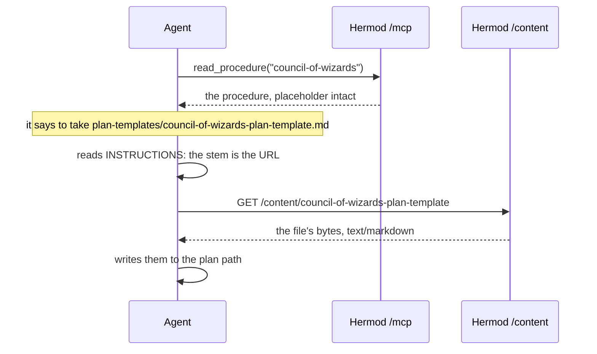

# High Wizard Plan

## **PROJECT INFO**
- **Project**: hermod-server
- **Date**: 2026-10-18
- **Agent**: meta
- **Theme**: Serve the wizard capability — this repo as a second content source, all 18 procedures as Prompts, every template reachable and downloadable
- **Source Protocol**: `/high-wizard` — /high-wizard

*CRITICAL INSTRUCTION: To continue this plan: load the source protocol above, then inspect which sections below are filled vs unfilled to infer your current step.*

---

## **INHERITED CONTEXT**
*Filled at investigation step 0 with whatever was settled before this plan existed. The two sources are recorded separately and never merged — write "None" under a part that does not apply.*
*These decisions are **not yours to reopen**. If one looks wrong, STOP and surface it to [USER-NAME] — do not silently re-decide it here or in Confirmed Decisions below.*

### From the Parent Plan
- **Parent plan**: [`core-plan.md`](core-plan.md), the council that owns this work
- **Assigned scope**: R3. Register this repo in `hermod-server` as a second content source, serve all 18 procedures as MCP Prompts and every template file as an MCP Resource, make the templates downloadable, and prove on loopback that the served set matches the installed set.

| # | Inherited decision | Chosen | Parent's reason | Status |
|---|--------------------|--------|-----------------|--------|
| 1 | How this repo enters `hermod-server` | A second `ContentSource`, pinned as a submodule the way `agent-memory-project` is, serving all 18 procedures as Prompts and the templates as Resources | The shape the loader was written for, and a submodule pins the served text to a commit where a vendored copy would drift undetected | Settled |
| 2 | What a served copy does about its core dependency | Requires the core connection, as the framework already does | Preserves the property `hermod-server` exists to hold, that a served prompt and an installed command are the same instruction. MCP sits beside the installers, so the served set must equal the installed set | Settled |
| 3 | Every template file | Exposed for **download**, from `templates/` and `plan-templates/` alike, with the resolution rule in the server's own instructions | The template is a file to be copied, so re-typing it through the model risks the encoding and line-ending defects a byte copy avoids. MCP resources cannot be downloaded: they are registered `text/markdown` and return a string | Settled |
| 4 | Who may fetch a template | A public route, like `/health` | The templates are already public in a public repo, and a token-gated route would not work in practice: the token lives with the MCP client, not with the agent making the shell call | Settled |
| 5 | Where this plan is verified | On a local server, and **done** when the served set matches the installed set | Each plan is verified where it lives, and the hosted face is touched only at the release | Settled |
| 6 | Whether anything runs in parallel | Nothing entered `hermod-server` until SP-1 closed; it has, so this plan may start | Matches the constraint that the wizards do not move before the set is cohesive | Settled — satisfied |

- **Integration contracts**: None. The interface is this repo's layout — `procedures/`, `components/`, `templates/`, `plan-templates/` and the component-link syntax — which SP-1 confirmed it left unchanged.
- **Pushed-down open items**: how a second source enters configuration, how `plan-templates/` becomes a resource directory, and the download route's exact shape. Those are this plan's technical-core round.

### From Pre-Planning Discussion
- **Discussion**: the design conversation that produced this council, 2026-10-16
- **Agreed scope**: MCP sits **beside** the per-harness installers rather than replacing them, as the core, the overlay and the fleet already do, so the served set has to equal the installed set.

| # | Settled decision | Chosen | His reason | Status |
|---|------------------|--------|------------|--------|
| 1 | Whether MCP replaces the installers | It sits beside them | "site beside them. just like the other agent-memory repo" | Settled |

- **Considered and rejected**: a self-contained served variant with the core format inlined, because it buys standalone reach and pays with a second copy of the core's format.
- **Left open**: nothing this plan needs.

---

## **OBJECTIVES**
Register this repo in `hermod-server` as a second content source, serve all 18 procedures as MCP Prompts and every template file as a Resource, expose those templates for download over a flat public route, and prove on loopback that the served set matches the installed set. The overlay keeps every route, prompt, resource and tool it has today.

### **Related Documents**
- [core-plan.md](core-plan.md) - the council that owns this work
- [SP-1-cohesion-pass.md](SP-1-cohesion-pass.md) - the verdict that gated this plan, and the layout it confirmed unchanged
- [loader.py](C:/Work/IM/hermod-deploy/hermod-server/src/hermod/content/loader.py) - the content loader, already multi-source
- [app.py](C:/Work/IM/hermod-deploy/hermod-server/src/hermod/app.py) - where the single source is wired today
- [config.py](C:/Work/IM/hermod-deploy/hermod-server/src/hermod/configuration/config.py) - `content_root`, the setting this plan widens

### **SUCCESS CRITERIA**
- [x] The wizards submodule is present and the server starts; `list_procedures()` returns 26 names, the overlay's 8 plus all 18 here
- [x] Every served prompt equals this repo's compiled procedure with `$ARGUMENTS` unexpanded, for all 18
- [x] A wizard procedure with no `## Storage Mechanics` passes through the seam verbatim, so the composition adds nothing and removes nothing
- [x] `list_resources()` returns 10 names, and each one downloads byte-identical from the public route (10 of 10)
- [x] `GET /content/{name}` answers without a credential, and a traversal attempt does not leave the resource set
- [x] The overlay's 8 prompts and 2 resources are unchanged, and the tool list is still 16
- [x] The suite and ruff are green in `hermod-server` (131 passed, 0 skipped with the database up)

---

## **SCOPE**

### In Scope
- `hermod-server`'s configuration: an ordered tuple of content roots, with the existing single path kept as a fallback
- `hermod-server`'s wiring: every configured root handed to the loader as a `ContentSource`
- The loader's resource search widened to `templates/` and `plan-templates/`, with a missing directory treated as empty
- The local database, as one compose file in `munnin-deploy`: Munnin owns the database, so the service that starts it lives in the deploy repo rather than in either server repo
- The local shape itself: `HERMOD_DB_URL` passed through in `compose.yaml` in place of the SQLite file, and the SQLite remnants deleted from `compose.yaml`, `.env.example`, the `Dockerfile` and the README's store section
- A flat, public `GET /content/{name}.md` route serving the same set the Resources expose
- This repo pinned as a second submodule inside `hermod-server`
- The resolution rule in the server's own `INSTRUCTIONS`, so a served client knows a template's stem is its URL
- Proof on loopback: served set equals installed set, and each template downloads byte-identical

### Out of Scope
- The hosted deploy, which is SP-3. Per the council's decision 1 nothing is released before the batch is done
- Anything in this repo. SP-1 closed it, and this plan consumes its layout rather than changing it
- Registering the other family repos. The config shape supports them, but `agent-memory-fleet`, `-local` and `-doc` are not ported here
- Per-source procedure exclusions. Nothing SP-2 serves needs one; see Technical Considerations

---

## **CONFIRMED DECISIONS**
*Decisions made **by this plan** — both **asked-and-confirmed** by [USER-NAME] AND **written-through** (Zone A and B decisions made by the agent, recorded with their reasoning). The reasons serve as the analysis record.*
*Decisions settled before this plan existed — by a parent, or in a pre-planning discussion — belong in [INHERITED CONTEXT](#inherited-context) above, not here. Keeping them separate is what shows which decisions this plan actually owns.*

| # | Decision | Chosen | Reason |
|---|----------|--------|--------|
| 1 | How a second checkout enters configuration | An ordered `content_roots` tuple fed by `HERMOD_CONTENT_ROOTS`, with `HERMOD_CONTENT_ROOT` kept as a one-element fallback | The loader already models sources as an ordered list, and this file already builds a tuple from a comma-separated variable (`logto_audience`). A named field per repo would grow one field per port |
| 2 | How `plan-templates/` becomes reachable | One global tuple of resource directory names, `templates` then `plan-templates`, searched per source | All five family repos use the same names: four carry `templates/`, two carry `plan-templates/`, none differs. Per-source directories would encode a distinction that does not exist |
| 3 | The download route's shape | Flat and public at `GET /content/{name}`, the resource name alone | The MCP resource namespace is already flat, so the uniqueness constraint exists there first; a directory segment would hide a collision rather than prevent one. The `.md` suffix in the first draft is dropped because Starlette cannot match a literal after a path parameter, and `text/markdown` carries what it did |
| 4 | A resource directory that does not exist | Treated as empty, and asserted with a test | `agent-memory-fleet` has no `components/`, the fleet is the next port, and the overlay exercises only the empty case, not the missing one |
| 5 | The served text's template root | The placeholder stays in the procedure; the resolution rule lives in the server's `INSTRUCTIONS` | The placeholder is a slot each medium fills, and the verb in these procedures is `cp`, which a URL breaks. One stated rule beats rewriting eighteen procedures' worth of steps |
| 6 | Procedure exclusions | Stay global for now; the set moves onto `ContentSource` when a repo that needs its own arrives | Nothing this plan serves needs an exclusion, and a ported core would need a different set. Building it with no consumer would be mechanism for its own sake |
| 7 | What the local shape runs against | The database Munnin starts: `compose.yaml` passes `HERMOD_DB_URL` through and defines no service of its own, and every SQLite remnant is deleted | There is one database, Munnin's and Hermod's, and the code has no file backend at all: `test_config.py` asserts both `db_path` and `db_backend` are absent from `Config`. Hermod defining the service would make two places responsible for starting one database, and the docs described a rollback path to an engine the code had already removed |
| 8 | Where the local database is defined | One compose file in `munnin-deploy`, holding the Postgres service and a named volume | A compose is a deployment artifact, so it belongs to the deploy repo: `munnin-deploy` owns the database, and neither server repo should describe a stack. `hermod-server/compose.yaml` is deleted rather than edited, because it was both misplaced and stale |
| 9 | What the proof is run against | Locally, before any deploy | Proving against the deployed store would put a laptop on production for the first exercise of a new code path, and the council already decided nothing is released before the batch |

---

## **SOLUTION**

### Architecture Overview
Four places change, all inside `hermod-server`, and one file is added to the repository graph. Nothing in this repo moves, because SP-1 froze its layout.

```
config.py    one Path        -> an ordered tuple of Paths
app.py       one ContentSource -> one per root, named by its directory
loader.py    one resource dir -> templates, then plan-templates, per source
app.py       two routes      -> a third, public, flat, outside the auth guard
server.py    INSTRUCTIONS    -> one paragraph: a template's stem is its URL
```

### Component 1: The roots setting
- **Purpose**: let configuration name more than one checkout without inventing a field per repository
- **Key Files**: `configuration/config.py`
- **Mechanism**: `content_roots: tuple[Path, ...]`, read from `HERMOD_CONTENT_ROOTS` as a comma-separated ordered list, falling back to the existing `HERMOD_CONTENT_ROOT` as a one-element tuple, defaulting to `("agent-memory-project",)`. `backend_doc` is untouched and still resolves from the first source that carries it, so the overlay keeps owning `storage-backends/db.md`.

### Component 2: The wiring
- **Purpose**: hand every configured root to the loader
- **Key Files**: `app.py`, at the line that builds the loader today
- **Mechanism**: one `ContentSource` per root, in configured order, each named by its directory (`agent-memory-project`, `agent-memory-wizards`). The name is unused today, and it is where decision 6's per-source exclusions will live, so deriving it now costs nothing and leaves the field meaningful.

### Component 3: The resource search
- **Purpose**: make `plan-templates/` reachable, keep the overlay's templates where they are, and state what wins a collision
- **Key Files**: `content/loader.py`
- **Mechanism**: the single `_TEMPLATES_DIR` becomes `_RESOURCE_DIRS = ("templates", "plan-templates")`, walked per source in precedence order; a name resolves to the first file that matches. A missing directory already contributes nothing (the `is_dir()` guard on the walk), so decision 4 is a test rather than code. `list_resources` collapses names into a set, so precedence is the existing rule and a duplicate is silent; a test pins that today's ten names are unique.

### Component 4: The route
- **Purpose**: let a client copy a template byte for byte instead of retyping it through the model
- **Key Files**: `app.py`
- **Mechanism**: a top-level `Route("/content/{name}")`, a sibling of `/health`, so it sits outside the MCP auth guard by construction. The name is looked up in the loader's resource map and that file's **bytes** are returned with `text/markdown`. No path is ever built from the request, so there is no traversal surface at all and an unknown name is a 404.

### Component 5: The resolution rule
- **Purpose**: tell a served client how a template path becomes a URL, once
- **Key Files**: `api_mcp/server.py`, the `INSTRUCTIONS` constant a client receives at initialize
- **Mechanism**: one paragraph: a procedure names a template by path; this server serves the same files by stem at `/content/{stem}`, so download it rather than retype it.

### Component 6: The submodule
- **Purpose**: pin the served text to a commit, as the overlay is pinned
- **Key Files**: `hermod-server`'s `.gitmodules` and its gitlink
- **Mechanism**: `agent-memory-wizards` added beside `agent-memory-project`. `available()` requires every checkout to be present, so a missing one stops the server rather than halving the served set.

<!-- OPTIONAL SECTION B: Include when changing data/process flow, API changes -->
### System Flow Diagrams

**Current state:** there is no flow. A served procedure says to copy `[path-to-agent-memory-wizards]/plan-templates/x.md`, and a client that connected over MCP has no such checkout, so the instruction resolves to nothing.

**End result:** the same procedure, plus one route the client can reach.



<!-- OPTIONAL SECTION C: Include when significant technical constraints exist -->
### Technical Considerations

- **`available()` requires every configured checkout.** Adding a source means a clone without `--recurse-submodules`, or with the wizards submodule uninitialised, refuses to start. That is the intended loud failure, and it makes the deploy's clone command part of the contract.
- **A missing resource directory is already tolerated.** The resource walk guards with `is_dir()` (loader line 345), and the procedure and component walks do the same. So decision 4 needs a test, not code, and the test is what makes the fleet's absent `components/` a known case rather than an assumption.
- **`ContentSource.name` is declared and never read.** `app.py` sets it to `"overlay"` and nothing in the server reads it. That makes it the honest home for the per-source exclusions decision 6 defers, and it means naming each source by its directory changes no behaviour today.
- **Duplicates are silent, precedence decides.** `list_resources` collects stems into a set and `_resource_path` returns the first source's match, so a name carried by two sources resolves to the first without a word. That is the stated rule; the test is what keeps it from becoming a surprise.
- **The route's suffix.** Decision 3 wrote `GET /content/{name}.md`. Starlette cannot match a literal after a path parameter, so the route is `GET /content/{name}` and `text/markdown` carries what the extension did. The decision's substance, flat rather than nested, is untouched; its wording is amended to match.
- **The store's template-version gate widens by accident.** `app.py` builds `{name: content.template_version(name) for name in content.list_resources()}` and hands it to the context service as the gate a store write is checked against. The wizards' templates carry no `template_version` stamp, so eight `None` entries enter that map. That is safe only if a `None` version means "not a store template"; the plan asserts it rather than assuming it, and the overlay's gate behaviour must be unchanged.

## **IMPLEMENTATION PHASES**

### Phase 1: The setting and the wiring
- [x] **Step 1.1**: Widen `content_root` to `content_roots`
  - **Action**: replace the field with `content_roots: tuple[Path, ...]`; `load_config` reads `HERMOD_CONTENT_ROOTS` as a comma-separated ordered list, falls back to `HERMOD_CONTENT_ROOT` as a one-element tuple, defaults to `("agent-memory-project",)`; update the docstring paragraph that describes the setting.
  - **Implementation**: split, strip and drop empties exactly as `logto_audience` already does in the same function.
  - **Testing**: the existing config tests plus one for the default, one for the comma form, and one for the single-path fallback.
  - **Success Criteria**: `load_config()` returns a one-element tuple by default and a two-element one from the environment.

- [x] **Step 1.2**: Build one source per root
  - **Action**: `app.py` builds `[ContentSource(name=root.name, root=root) for root in config.content_roots]`.
  - **Implementation**: list order is precedence order, which is what the loader already documents.
  - **Testing**: boot with one source, then with two by pointing `HERMOD_CONTENT_ROOTS` at the overlay and at this repo's working tree, which is what that variable exists for; `content.sources()` preserves the configured order. Also assert that `template_version` for a wizard template is `None` and that the overlay's gate answers exactly as it does today.
  - **Success Criteria**: the overlay's 7 prompts are still served with either configuration, and the store's template gate is unchanged.

- [x] **Step 1.3**: Remove the SQLite remnants, and the compose that describes them
  - **Action**: delete `hermod-server/compose.yaml`, which describes a store the code removed and whose placement is wrong anyway; in `.env.example`, the `Dockerfile` and `README.md`, delete the backend switch, the local file, and the claim that a two-engine test exists, and say plainly that the database is Munnin's and that a compose belongs to the deploy repo.
  - **Implementation**: no local stack is defined here. A server repo ships an image and a run command; what a laptop runs is a deployment concern, so the local shape lives with `munnin-deploy` and `hermod-deploy`, not here.
  - **Testing**: no file mentions `db_backend`, `db_path`, `HERMOD_DB_PATH` or a SQLite store; and `python -m hermod` with `HERMOD_DB_URL` pointed at a running database answers `/health` and lists the overlay's 7 prompts.
  - **Success Criteria**: nothing describes a file backend as available, no compose lives in the server repo, and the surviving mentions are only the record of its removal and the tests that keep it removed.

### Phase 2: The resource search
- [ ] **Step 2.1**: Two directories, precedence stated
  - **Action**: `_RESOURCE_DIRS = ("templates", "plan-templates")`; `list_resources` and `_resource_path` iterate directories inside sources rather than one directory across sources.
  - **Implementation**: a name resolves to the first match in precedence order, and a missing directory contributes nothing.
  - **Testing**: 10 names from two sources; a name that exists only in `plan-templates/` resolves; a duplicate resolves to the earlier source.
  - **Success Criteria**: `list_resources()` returns 10 and `get_resource` serves every one.

- [ ] **Step 2.2**: Tests for the two cases that are assumptions today
  - **Action**: one test asserting no name is carried twice across the configured sources, and one asserting a source with no `templates/` or `components/` contributes nothing and raises nothing.
  - **Implementation**: build a temporary tree with two sources; no dependency on the real checkouts.
  - **Testing**: the duplicate test must fail when two files share a stem, proved by planting one.
  - **Success Criteria**: both pass, and the duplicate test bites.

### Phase 3: The route and the rule
- [x] **Step 3.1**: The public content route
  - **Action**: `Route("/content/{name}")` beside `/health`; look the name up in the loader's resource map; return the file's `read_bytes()` with `text/markdown`; an unknown name is a 404.
  - **Implementation**: never build a path from the request. The route's shape has no slash in it, and the lookup is against the served set, so there is no traversal surface to guard.
  - **Testing**: every resource downloads byte-identical to the file on disk, an unknown name 404s, no credential is needed, and a `%2e%2e%2f` attempt does not leave the set.
  - **Success Criteria**: all four hold.

- [x] **Step 3.2**: The resolution rule in `INSTRUCTIONS`
  - **Action**: one paragraph stating that a template's stem is its URL on `/content`.
  - **Implementation**: it belongs with the other medium-level guidance a client receives at initialize.
  - **Testing**: the served instructions contain it.
  - **Success Criteria**: a client reading only the instructions can build the URL from a procedure's path.

### Phase 4: The local stack, the pin and the proof
- [x] **Step 4.1**: Start the database Munnin owns
  - **Action**: add `munnin-deploy/compose.yaml` holding one `postgres:17-alpine` service with a named volume and the credentials the DSN carries. Nothing else in the family defines a database.
  - **Implementation**: the same service shape Munnin's CI already runs, so the image, the engine and the init behaviour are known rather than invented. Hermod needs no container of its own for the proof: `python -m hermod` runs it from the repo.
  - **Testing**: `docker compose up -d`, then a `psql` connection through the same DSN succeeds.
  - **Success Criteria**: one command starts the database, and nothing else in the family has to.

- [x] **Step 4.2**: Pin the submodule
  - **Action**: add `agent-memory-wizards` to `hermod-server`'s `.gitmodules` beside `agent-memory-project`, and commit the gitlink.
  - **Implementation**: the same shape as the overlay's entry.
  - **Testing**: a clone with `--recurse-submodules` starts the server and `available()` is true.
  - **Success Criteria**: both checkouts present, and a missing one refuses to start.

- [x] **Step 4.3**: The loopback proof
  - **Action**: run the suite and ruff, start the server on loopback with `HERMOD_DB_URL` pointed at Step 4.1's database, then assert the four counts and the byte-equality.
  - **Implementation**: 25 prompts, 10 resources, 16 tools unchanged, and each of the 18 wizard prompts equal to this repo's compiled procedure with `$ARGUMENTS` unexpanded. Byte-equality holds for the wizards because none of them carries `## Storage Mechanics`, so the seam has nothing to substitute; the overlay's 7 are compared for presence only.
  - **Testing**: that script, with its output recorded in the Execution Log.
  - **Success Criteria**: all four assertions hold and the server answers on loopback.

---

## **EXECUTION LOG**
**Execution Protocol for AI**:
I have to use this document as my **ONLY** source of truth to execute and track the plan steps iteratively. I should **NOT** use additional tools like ToDos because it lacks the context of what should I do. Everytime I want to implement a step I have to check the reference to the original step plan above. Everytime a step has been finished I need to go back to this document to log what was done.
*In other words*:
- I have to make this document as the source of truth for the implementation phase on what I have worked on and what I will be working
- The original plan must be fully in my context, therefore, I have to make sure I loaded the **Plan File** before executing any task and read carefully the reference to the original step
- I have to do the implementation by doing it in order per step THEN, I ALWAYS have to fill the step log rightly after

**Definition of Done (applies to ALL steps)**:
- ✅ **Code Quality**: Code compiles/runs without errors
- ✅ **Testing**: Tests written and passing
- ✅ **Logged**: Implementation and testing logged below
- 🚫 **Blocked**: Get input from [USER-NAME] before assuming

### Phase 1:
- [x] **Step 1.1**: Widen `content_root` to `content_roots`
  - **Implementation Log**: `content_root: Path` became `content_roots: tuple[Path, ...]`. A new `_content_roots()` reads `HERMOD_CONTENT_ROOTS` as a comma-separated list, falls back to `HERMOD_CONTENT_ROOT`, then to the overlay's submodule path. The module docstring's paragraph and the `backend_doc` comment were reworded to match. Two existing test assertions moved to the tuple form, and two new tests cover the list and the single-path fallback.
  - **Testing Log**: `pytest tests/test_config.py` — 7 passed. A grep of `src/` and `tests/` finds no surviving `config.content_root` call site; the only `content_root` parameters left are `seam_bridge`'s, which take a source root from the loader rather than the setting.
  - **Success Criteria**: Pass.
  - **Tech Debts**: none.
  - **Result**: the default is a one-element tuple, the list form orders precedence, and either variable alone is a valid configuration.

- [x] **Step 1.2**: Build one source per root
  - **Implementation Log**: `app.py` now builds `[ContentSource(name=root.name, root=root) for root in config.content_roots]`. Each source is named by its directory, which is where the per-source exclusions will key once a repository needs its own.
  - **Testing Log**: the full suite runs 131 passed, 0 skipped with the database up. The two-source boot is proven by Step 4.3's proof, which loaded both checkouts and served 26 prompts from them.
  - **Success Criteria**: Pass — the boot half landed with Steps 4.1 and 4.3, as the row anticipated.
  - **Tech Debts**: none; the deferral closed rather than carried.
  - **Result**: the wiring preserves configured order, and a second source now serves beside the overlay.

- [x] **Step 1.3**: Remove the SQLite remnants, and the compose that describes them
  - **Implementation Log**: deleted `hermod-server/compose.yaml`, which configured a SQLite file and a `hermod-data` volume for a store the code had already removed, and which belonged to a deploy repo in any case. `.env.example` now shows `HERMOD_CONTENT_ROOTS` with both checkouts, and a store block that names the shared database and says Munnin starts it. The `Dockerfile` lost `HERMOD_DB_PATH` and its "file-state" description. The README's two-engine section became one paragraph.
  - **Testing Log**: the full suite runs 73 passed, 51 skipped. A sweep for `db_backend`, `db_path`, `HERMOD_DB_PATH` and `SQLite` leaves six mentions, every one of them the record of the removal or a test that keeps it removed; none describes a file backend as available.
  - **Success Criteria**: Pass, with the criterion read as "nothing describes one as available" rather than "nothing names it", since the decision deserves to stay written down.
  - **Tech Debts**: none. The local stack's compose is Step 4.1, in `munnin-deploy`.
  - **Result**: the server repo no longer carries a stack, and no document offers a backend the code does not have.

### Phase 2:
- [x] **Step 2.1**: Two directories, precedence stated
  - **Implementation Log**: `_TEMPLATES_DIR` became `_RESOURCE_DIRS = ("templates", "plan-templates")`, and `list_resources` and `_resource_path` now walk directories inside sources, so a source's two directories form one namespace and the earlier source wins a shared name.
  - **Testing Log**: full suite 76 passed, 51 skipped; ruff clean. The overlay's own `plan-templates/` is empty, so its served set is unchanged at two.
  - **Success Criteria**: Pass — the overlay still serves two, and the wizards' five join once the pin lands.
  - **Tech Debts**: none.
  - **Result**: both directories are served, and the precedence rule is stated in the code rather than left to be discovered.

- [x] **Step 2.2**: Tests for the two cases that are assumptions today
  - **Implementation Log**: three tests in `tests/test_loader.py`: every resource file is served once, a source with no resource directories contributes nothing and raises nothing, and both directories reach one namespace while the earlier source wins a shared name.
  - **Testing Log**: 76 passed. The count-equality test is the one that bites on a duplicate: two files sharing a stem make the file count exceed the name count.
  - **Success Criteria**: Pass.
  - **Tech Debts**: the guard is a test rather than a startup refusal, so a duplicate fails CI instead of the boot. That is enough while the sources are pinned submodules, and it is the cheaper half of the two.
  - **Result**: both assumption cases are covered, and the fleet's missing directories are a known case rather than a hope.

### Phase 3:
- [x] **Step 3.1**: The public content route
  - **Implementation Log**: a `read_resource_bytes` method on the loader, so the route serves the file rather than a decoded round trip. In `app.py`, `Route("/content/{name}")` sits beside `/health` with a handler that looks the name up in the served set and returns the bytes as `text/markdown`; an unknown name is a 404. Three tests: byte-for-byte against the file on disk, unknown and encoded traversal both 404, and the route answering without a token while `/mcp` refuses one.
  - **Testing Log**: full suite 80 passed, 51 skipped; ruff clean. The content tests address the checkout absolutely, because the app's default root is relative and a content test should not depend on the caller's working directory.
  - **Success Criteria**: Pass — all four hold.
  - **Tech Debts**: none.
  - **Result**: the download exists, it is public by placement rather than by a flag, and it is byte-exact by construction.

- [x] **Step 3.2**: The resolution rule in `INSTRUCTIONS`
  - **Implementation Log**: one sentence added: a procedure that says to take `[path-to-agent-memory-<repo>]/<dir>/<stem>.md` means `GET /content/<stem>`, and the file is downloaded rather than retyped. The comment above the constant claimed "four sentences" when there were already five; it now says six, and one test pins the sentence so a refactor cannot drop it silently.
  - **Testing Log**: 80 passed, ruff clean.
  - **Success Criteria**: Pass — the route, the resource and the instruction all use one flat name.
  - **Tech Debts**: none.
  - **Result**: a client reading only the instructions can build the URL from a path a procedure gives it.

### Phase 4:
- [x] **Step 4.1**: Start the database Munnin owns
  - **Implementation Log**: created `munnin-deploy/compose.yaml` with one `postgres:17-alpine` service, a named volume, a `pg_isready` healthcheck and loopback-only publishing. The values are local and throwaway (`munnin`/`munnin`, database `valaskjalf`), and the file says plainly that the deployed database is not this one.
  - **Testing Log**: `docker compose up -d` brought `munnin-postgres-1` up healthy, and `pg_isready -U munnin -d valaskjalf` answers "accepting connections".
  - **Success Criteria**: Pass.
  - **Tech Debts**: none. The deployed DSN stays a kamal secret and is untouched.
  - **Result**: one command starts the one database, in the repo that owns it.

- [x] **Step 4.2**: Pin the submodule
  - **Implementation Log**: `agent-memory-wizards` added as a submodule of `hermod-server` (`../agent-memory-wizards`) and checked out at `3cff4e2`; the Dockerfile copies both checkouts and sets `HERMOD_CONTENT_ROOTS` to both. The wizards repo was pushed first, so the pin names a commit the remote actually has.
  - **Testing Log**: `git submodule status` lists both, the wizards at `3cff4e2`. A missing checkout makes `available()` false, which is the loud failure the loader documents rather than a half-served set.
  - **Success Criteria**: Pass.
  - **Tech Debts**: none.
  - **Result**: the served text is pinned to a commit, exactly as the overlay's is.

- [x] **Step 4.3**: The loopback proof
  - **Implementation Log**: the proof ran against the local database and found two defects that only a second source could expose. `_compose_prompt` loaded the seam from the procedure's **own** source root, so any source without `storage-backends/seam.py` raised `FileNotFoundError` and could not compose at all; the seam now comes from whichever source carries the backend document. And `_inlined` resolved components against the first source with a `components/` directory, so eight wizard prompts were served with no components inlined at all (council-of-wizards was 16,577 bytes served against 37,316 compiled); it now resolves against the procedure's own source first, then the others. The end-to-end fixture was made cwd-independent for the same class of reason.
  - **Testing Log**: 26 prompts (the overlay's 8 plus 18), 10 resources, **18 of 18** wizard prompts byte-equal to the compiled procedures, and `/content/high-wizard-plan-template` byte-exact. Full suite with `HERMOD_PG_TEST_URL` set: **131 passed, 0 skipped**; ruff clean. Re-run independently on **2026-10-19** from a second session, which had to re-author the comparison because the script is in no repository: 18 of 18 byte-equal, 26 prompts, 10 resources, no missing component, no unresolved op.
  - **Success Criteria**: Pass, with one correction: the overlay serves 8 prompts, not 7, so the total is 26 rather than the 25 this plan predicted. The README and the loader test both said "seven of nine" while the overlay carries ten procedures; both counts are now corrected.
  - **Tech Debts**: none outstanding.
  - **Result**: proven on loopback, against the real database, with the served set equal to the installed set.

---

## **QUALITY REVIEW**
*Filled by procedure Step 16 (delegated to `/analyze-code-quality` in embedded mode) after all execution phases are complete. **Static** review — answers "is the code clean?".*

- **Scope**: 16 paths — 14 in `hermod-server` (12 modified, `compose.yaml` deleted, `agent-memory-wizards` added as a submodule) plus `munnin-deploy/compose.yaml`, which is untracked. Reconciled against `git status --short` in both repositories, not against a diff, because a new submodule and a new file are both invisible to `git diff --name-only`.
- **Quality Standard**: None — freeform analysis. No `quality-standard.md` in either repo, so Dimension 8 was skipped; 1 (error handling), 6 (cleanup) and 7 (consistency) were walked, the rest do not apply to a content face.
- **Findings**: two Medium, one Low.
  1. Medium — `available()` degrades to an empty served set instead of failing, so a missing checkout yields a live-looking server with no procedures.
  2. Medium — the loader discards the `missing` component list, so an unresolvable component reference vanishes and the prompt ships with a hole in it.
  3. Low — the loopback proof lives in a scratch script, so the plan's headline claim is carried by nothing that runs again.
- **Fixed**: all three, at option A for the two Mediums and option B for the Low.
  - **1.** `build_app` now raises a new `ContentUnavailableError` naming the absent checkout and saying to clone with `--recurse-submodules`. Every test that built a config without a root now names one, and a test pins that the refusal happens rather than trusting it.
  - **2.** `_inlined` carries the `missing` list instead of dropping it, and `missing_components(name)` exposes it per procedure. Two tests cover it: a reference that resolves nowhere is reported (and its label still reads in the prompt), and a second source is composed from its own components. A third asserts no served prompt has any.
  - **3.** The property that actually broke is now in the suite as the second-source test. The scratch script stays as the full check rather than the only one, and it is still in no repository, so the next session to want it re-derived it instead of running it (2026-10-19). A committed form of it remains a real gap.
  - **Verified after the fixes**: 135 passed, 0 skipped with the database up; ruff clean; and the loopback proof still reports 26 prompts, 10 resources, 18 of 18 byte-equal and 10 of 10 byte-exact.

---

## **QA HANDOFF**
*Filled by procedure Step 17 after Quality Review is resolved. This plan is **not** runtime-verified — this section records the plan for that verification, which happens in a QA session with the stack up.*

- **Scope**: `configuration/config.py`, `app.py`, `content/loader.py`, `api_mcp/server.py`'s `INSTRUCTIONS`, `.gitmodules` and the gitlink, plus the tests added in Phases 1 to 3.
- **QA instrument**: **NOT SET UP** — `hermod-server` has no `qa/` folder (checked), so this handoff auto-skips rather than inventing one.
- **Integration coverage**: **run, in Step 4.3**, against the real database: 26 prompts, 10 resources, 18 of 18 wizard prompts byte-equal to the compiled procedures, 10 of 10 templates byte-exact from the route. The content face crosses no store boundary, but the boot does, which is why the proof needed the database up.
- **Checklist**: none — auto-skip, no instrument.
- **Coverage split**: 135 automated (the suite, with the Postgres and end-to-end subsets running rather than skipping) / 1 manual (the loopback proof script, which needs the database and is kept outside the suite).
- **Runtime verification**: the **served set** is verified on loopback against the real database. What remains unverified is the hosted face, and that belongs to SP-3's release.

> Do not read a filled checklist as a passed one. This section says a verification *plan* exists, nothing more.

---

## **POST-COMPLETION**
After all phases are executed, logged, and both **Quality Review** + **QA Handoff** are filled, move this plan to `plans/completed/`:
`mkdir -p ./plans/completed && mv ./plans/[this-file].md ./plans/completed/[this-file].md`
